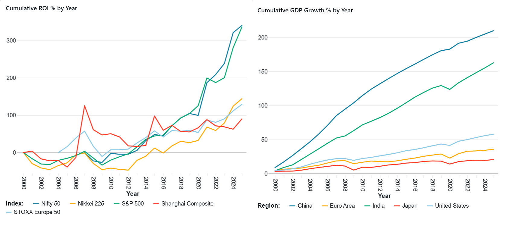
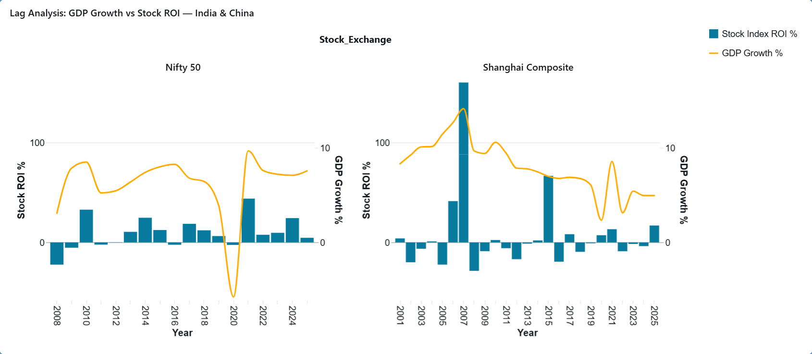
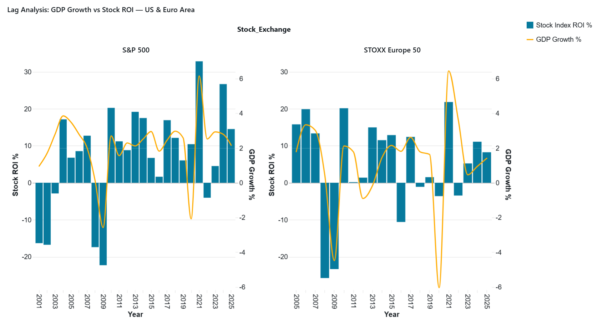
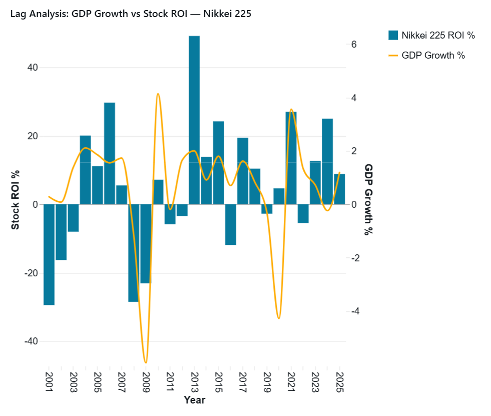
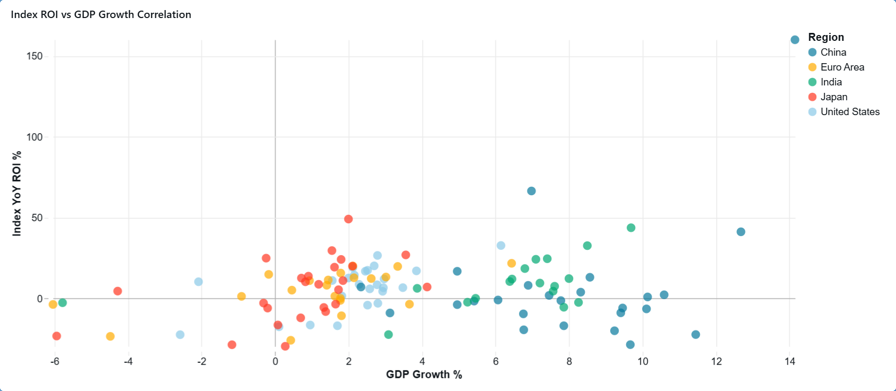

# Global Stock Market & Macroeconomic Analytics Pipeline

An end-to-end, enterprise-grade data engineering pipeline deployed on **Databricks** using **Delta Lake**, **Databricks Serverless Workflows**, and the **Medallion Architecture** (`bronze`, `silver`, `gold`).

The pipeline ingests financial stock indices and global macroeconomic GDP indicators, harmonizes business-day trading calendars, enforces schema validation, and builds a high-performance Star Schema optimized for financial analytical dashboards.

## 📌 Project Overview

Understanding global stock index movements in relation to macroeconomic growth requires clean, synchronized historical datasets. This project automates the ingestion, transformation, and incremental loading of financial and economic data across five major world markets:

* **USA:** S&P 500 (`^GSPC`) / USD
* **Euro Area (EMU):** STOXX Europe 50 (`^STOXX`) / EUR
* **China:** Shanghai Composite (`000001.SS`) / CNY
* **Japan:** Nikkei 225 (`^N225`) / JPY
* **India:** Nifty 50 (`^NSEI`) / INR

### Key Features

* **Medallion Architecture:** Strict separation into Bronze (Raw Ingestion), Silver (Standardized & Validated), and Gold (Star Schema Dimensions & Facts).
* **Dual Ingestion Patterns:** Supports both an **Initial Backfill Load** (2000–2019) and an **Automated Incremental Load** using dynamic watermark tracking on Delta tables.
* **Master Business Calendar Alignment:** Left-joins all stock index tables onto a master business-day calendar (`freq='B'`) to eliminate non-trading gap discrepancies across international markets.
* **Orchestration with Databricks Jobs:** Fully automated DAG execution pipelines running on Databricks Serverless Compute.
* **Query Performance Optimization:** Delta Lake `OPTIMIZE` and `Z-ORDER BY` applied on primary join keys (`Date`, `Date_Key`, `Year`, `Region_Key`).
* **Interactive Analytics Dashboard:** Built-in Databricks dashboard providing macro-financial trend analysis, lag analysis, and correlation insights.

## 🏗️ Technical Architecture & Workflow DAGs

### 1. Initial Load Workflow (`Initial_load`)

The initial load builds the catalog schemas, executes multi-decade historical backfills in parallel, performs data quality audits, and populates the Gold dimensional model.

```
                  ┌──────────────────────────────┐
                  │        create_schemas        │
                  │  (00_setup_schemas.sql)      │
                  └──────────────┬───────────────┘
                                 │
                 ┌───────────────┴───────────────┐
                 ▼                               ▼
    ┌─────────────────────────┐     ┌─────────────────────────┐
    │     load_gdp_data       │     │     load_stock_data     │
    │  (ingest_gdp_data.py)   │     │ (ingest_stock_data.py)  │
    └────────────┬────────────┘     └────────────┬────────────┘
                 │                               │
                 ▼                               ▼
    ┌─────────────────────────┐     ┌─────────────────────────┐
    │     clean_gdp_data      │     │    clean_stock_data     │
    │(gdp_clean_and_validate) │     │(stock_data_clean_and_...)│
    └────────────┬────────────┘     └────────────┬────────────┘
                 │                               │
                 └───────────────┬───────────────┘
                                 │
                                 ▼
                  ┌──────────────────────────────┐
                  │      create_gold_tables      │
                  │     (gold_tables_create)     │
                  └──────────────────────────────┘
```

### 2. Incremental Load Workflow (`Incremental_load`)

The incremental load dynamically computes the latest watermark from the target Delta tables (`MAX(Date)` and `MAX(Year)`), fetches only new records from external APIs, and appends them down the Medallion stack.

```
    ┌─────────────────────────┐     ┌─────────────────────────┐
    │  incremental_load_gdp   │     │incremental_load_stock...│
    │(ingest_incremental_gdp) │     │(ingest_incremental_stk) │
    └────────────┬────────────┘     └────────────┬────────────┘
                 │                               │
                 ▼                               ▼
    ┌─────────────────────────┐     ┌─────────────────────────┐
    │     clean_gdp_data      │     │    clean_stock_data     │
    │(gdp_clean_and_validate) │     │(stock_data_clean_and_...)│
    └────────────┬────────────┘     └────────────┬────────────┘
                 │                               │
                 └───────────────┬───────────────┘
                                 │
                                 ▼
                  ┌──────────────────────────────┐
                  │      update_gold_tables      │
                  │     (gold_tables_update)     │
                  └──────────────────────────────┘
```

## 📊 Medallion Layer Specifications

Catalog Scope: `db_miniproject_finance_ws`

### 🥉 Bronze Layer (Raw API Ingestion)

Raw datasets are ingested directly from external REST/Python APIs (`yfinance` and `wbgapi`) and persisted as raw Delta tables with appended ingestion timestamps.

| Table Name | Source | Description | Ingestion Pattern |
| :--- | :--- | :--- | :--- |
| `bronze.sp500_initial` | `yfinance` (`^GSPC`) | Daily S&P 500 OHLCV data | Overwrite / Append |
| `bronze.stoxx_eu_initial` | `yfinance` (`^STOXX`) | Daily STOXX Europe 50 OHLCV data | Overwrite / Append |
| `bronze.ssec_initial` | `yfinance` (`000001.SS`) | Daily Shanghai Composite OHLCV data | Overwrite / Append |
| `bronze.nikkei_initial` | `yfinance` (`^N225`) | Daily Nikkei 225 OHLCV data | Overwrite / Append |
| `bronze.nsei_initial` | `yfinance` (`^NSEI`) | Daily Nifty 50 OHLCV data | Overwrite / Append |
| `bronze.gdp_macro_raw` | World Bank API | Annual GDP Growth Pct (`NY.GDP.MKTP.KD.ZG`) | Overwrite / Append |

### 🥈 Silver Layer (Cleansing, Validation & Pivot)

The Silver layer sanitizes data, enforces strict PySpark schema typing, removes duplicate trading dates, and joins stock data onto a unified business calendar.

* **Stock Data Transformations:**
  * Master business calendar generated using `pandas.date_range(freq='B')`.
  * Multi-index flattening on API outputs.
  * Schema casting (`TimestampType`, `FloatType` for OHLC, `LongType` for Volume).
  * Automated deduplication checks on `Date`.
  * Optimizations: `OPTIMIZE silver.<table_name> ZORDER BY (Date)`.

* **GDP Data Transformations:**
  * Long-to-Wide conversion using PySpark `.pivot("Country_Code")` (`USA`, `EMU`, `CHN`, `JPN`, `IND`).
  * Automated null audits across indicator columns.

| Table Name | Structure / Contents |
| :--- | :--- |
| `silver.sp500_cleaned` | Cleaned S&P 500 trading daily metrics |
| `silver.stoxx_eu_cleaned` | Cleaned STOXX Europe 50 daily metrics |
| `silver.ssec_cleaned` | Cleaned Shanghai Composite daily metrics |
| `silver.nikkei_cleaned` | Cleaned Nikkei 225 daily metrics |
| `silver.nsei_cleaned` | Cleaned Nifty 50 daily metrics |
| `silver.gdp_macro_cleaned` | Cleaned yearly GDP growth rates pivoted by region |

### 🥇 Gold Layer (Star Schema Data Model)

The Gold layer provides analytical Star Schema dimensions and facts for reporting.

```
          ┌────────────────────────┐
          │     gold.dim_region    │
          ├────────────────────────┤
          │ PK  Region_Key         │
          │     Country_Code       │
          │     Region_Name        │
          │     Stock_Exchange     │
          │     Currency_Code      │
          └───────────┬────────────┘
                      │
            ┌─────────┴─────────┐
            │                   │
            ▼                   ▼
┌───────────────────────┐   ┌───────────────────────────────┐
│ gold.fact_daily_stock_│   │gold.fact_yearly_macro_indica..│
│      performance      │   │                               │
├───────────────────────┤   ├───────────────────────────────┤
│ PK  Stock_Key         │   │ PK  Macro_Key                 │
│ FK  Date_Key          │   │     Year                      │
│ FK  Region_Key        │   │ FK  Region_Key                │
│     Open              │   │     GDP_Growth_Pct            │
│     Close             │   └───────────────────────────────┘
│     High              │
│     Low               │
│     Volume            │
└───────────┬───────────┘
            │
            ▼
┌───────────────────────┐
│     gold.dim_date     │
├───────────────────────┤
│ PK  Date_Key          │
│     Full_Date         │
│     Day_of_Week       │
│     Day_Number_Of_..  │
│     Month_Name        │
│     Month_Number      │
│     Quarter           │
│     Year              │
└───────────────────────┘
```

## 📈 Analytics Dashboard & Reporting (`Analysis`)

The pipeline connects directly to a **Databricks Lakehouse Dashboard** powered by Gold star-schema tables.

### 1. Index and GDP Growth

Tracks cumulative market index growth and GDP expansion side-by-side across regions.



* **Cumulative ROI % by Year:** Comparative line chart tracking long-term compounded returns across all five market indices (S&P 500, Nifty 50, Nikkei 225, STOXX Europe 50, Shanghai Composite).
* **Cumulative GDP Growth % by Year:** Multi-region trend visualization tracking economic expansion across China, Euro Area, India, Japan, and the United States.

---

### 2. Lag Analysis

Evaluates the lead/lag dynamic between annual macroeconomic expansion ($\text{GDP Growth \%}$) and financial market returns ($\text{Stock Index ROI \%}$) using dual-axis visual models across regional focus panels:

#### India & China Lag Analysis

* Compares Nifty 50 and Shanghai Composite annual stock ROI against regional GDP growth rates.

#### US & Euro Area Lag Analysis

* Contrasts S&P 500 and STOXX Europe 50 performance against underlying GDP contractions and expansions.

#### Japan (Nikkei 225) Lag Analysis

* Tracks Japan's financial market responsiveness relative to its domestic macro growth cycle.

---

### 3. Index vs GDP Correlation

Analyzes the statistical relationship and clustering behavior between annual stock index yields and national GDP growth.



* **Scatter Plot Matrix:** Maps $\text{Index YoY ROI \%}$ (Y-axis) against $\text{GDP Growth \%}$ (X-axis) color-coded by region, illustrating market sensitivity to GDP growth volatility.

## 📁 Repository Directory Structure

```text
.
├── notebooks/
│   ├── 01_bronze/
│   │   ├── creating_schemas.sql               # Creates bronze, silver, gold schemas
│   │   ├── ingest_stock_data.py               # Initial backfill for stock indices
│   │   ├── ingest_gdp_data.py                 # Initial backfill for World Bank GDP metrics
│   │   ├── ingest_incremental_stock_data.py   # Watermark-based incremental stock load
│   │   └── ingest_incremental_gdp_data.py     # Watermark-based incremental GDP load
│   ├── 02_silver/
│   │   ├── stock_data_clean_and_validate.ipynb # Business calendar join, deduplication & Z-Order
│   │   └── gdp_clean_and_validate.ipynb        # Data pivoting, typing & quality validation
│   ├── 03_gold/
│   │   ├── gold_tables_create.ipynb            # Initial creation of dim_date, dim_region & facts
│   │   └── gold_tables_update.ipynb            # Dynamic watermark append engine for Gold facts
│   └── 00_utils/
│       └── drop_all_tables.ipynb               # Utility script to clear environment for fresh runs
├── docs/
│   └── images/                                 # Dashboard screenshots for README documentation
├── workflows/
│   ├── initial_load_workflow.json             # Databricks Job DAG definition for initial backfill
│   └── incremental_load_workflow.json         # Databricks Job DAG definition for updates
└── README.md
```

## 🛠️ Performance Tuning & Engineering Highlights

1. **Incremental Watermarking:** Gold update scripts dynamically calculate the watermark (`MAX(Full_Date)` or `MAX(Year)`) prior to reading Silver tables, skipping execution when no new records exist.
2. **Databricks Serverless Compute:** Workflows execute on Serverless Compute clusters, reducing total pipeline runtime to \~1m 50s per incremental run and eliminating cluster start-up overhead.
3. **Z-Ordering & File Compaction:**
   ```sql
   OPTIMIZE gold.fact_daily_stock_performance ZORDER BY (Date_Key, Region_Key);
   OPTIMIZE gold.fact_yearly_macro_indicators ZORDER BY (Year, Region_Key);
   ```

## 🚀 Execution Guide

### Prerequisites

* Databricks Workspace with Unity Catalog / Workspace Catalog enabled.
* Python packages installed on compute node: `yfinance`, `wbgapi`, `pandas`, `pyspark`.

### Pipeline Deployment

1. **Fresh Environment Initialization:**
   Run `notebooks/00_utils/drop_all_tables.ipynb` if resetting existing schemas.

2. **Execute Initial Backfill Job:**
   Trigger the `Initial_load` Job in Databricks Workflows.

3. **Execute Incremental Updates:**
   Trigger the `Incremental_load` Job manually or set a cron schedule for daily/weekly incremental updates.
